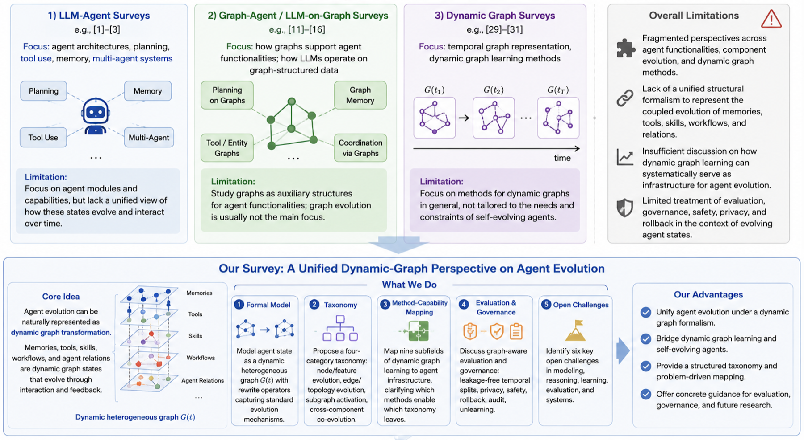

# Awesome Agent Dynamic Graphs

[](https://awesome.re)
[](https://arxiv.org/abs/2608.18104)

Papers and resources on **self-evolving agents through dynamic graph transformation**: evolving memory, tools, skills, workflows, and multi-agent coordination.

[Read the Survey](https://arxiv.org/abs/2608.18104) · [Paper Explorer](https://luckygirl-xu.github.io/Awesome-Agent-Dynamic-Graphs/) · [Full Paper Lists](#full-paper-lists) · [Citation](#citation) · [Contributing](CONTRIBUTING.md)

## The Survey

**[Self-Evolving Agents as Dynamic Graph Transformation: A Survey and New Perspective](https://arxiv.org/abs/2608.18104)**

Yuanyuan Xu, Wenjie Zhang, Yin Chen, Xuemin Lin, Ying Zhang · 2026

We study agent evolution through changes to nodes, features, edges, and activated subgraphs, connecting agent mechanisms with dynamic graph learning and graph-aware evaluation.

[arXiv](https://arxiv.org/abs/2608.18104) · [Preprints.org](https://www.preprints.org/manuscript/202606.1695) · [ResearchGate](https://www.researchgate.net/publication/406927066_Self-Evolving_Agents_as_Dynamic_Graph_Transformation_A_Survey_and_New_Perspective) · [References](https://www.researchgate.net/publication/406927066_Self-Evolving_Agents_as_Dynamic_Graph_Transformation_A_Survey_and_New_Perspective/references)

<details>
<summary>View the survey overview</summary>



</details>

## Getting Started

1. **Understand the perspective.** Read the survey's formulation of evolving agent states as typed, dynamic graphs.
2. **Choose an evolution mechanism.** Explore [node and feature updates](papers/agent-evolution.md#node-and-feature-evolution), [topology changes](papers/agent-evolution.md#edge-and-topology-evolution), [subgraph activation](papers/agent-evolution.md#subgraph-activation), or [cross-component co-evolution](papers/agent-evolution.md#cross-component-co-evolution).
3. **Connect methods to evaluation.** Browse [graph learning infrastructure](papers/graph-infrastructure.md), [evaluation and governance](papers/evaluation-governance.md), and [benchmarks](papers/benchmarks.md).

## Full Paper Lists

**Each link opens a complete paper list.** Use the [Paper Explorer](https://luckygirl-xu.github.io/Awesome-Agent-Dynamic-Graphs/) to search across sections and filter by year or topic.

| Collection | Coverage |
| --- | --- |
| [Agent Evolution — Full paper list](papers/agent-evolution.md) | Node and feature evolution; edge and topology evolution; subgraph activation; cross-component co-evolution. |
| [Graph Infrastructure — Full paper list](papers/graph-infrastructure.md) | Representation learning, text-attributed graphs, generation, continual learning, distribution shifts, temporal knowledge graphs, anomaly detection, unlearning, and explanation. |
| [Evaluation & Governance — Full paper list](papers/evaluation-governance.md) | Graph-aware evaluation, temporal protocols, privacy and deletion, safety, rollback, audit, and open challenges. |
| [Benchmarks — Full paper list](papers/benchmarks.md) | Memory, tool use, web and OS interaction, software engineering, safety, and dynamic graphs. |

Papers are organized by their role in the survey, including related foundations and evaluation resources. A paper may appear in multiple collections.

## Related Resources

- [Awesome Temporal & Dynamic Graph Learning](https://github.com/LuckyGirl-XU/Awesome-DynamicGraphLearning) — methods, code, and benchmarks for temporal graph learning.

## Contributing

Suggest papers, report corrections, or improve the taxonomy through an [issue](https://github.com/LuckyGirl-XU/Awesome-Agent-Dynamic-Graphs/issues/new/choose) or pull request. See [CONTRIBUTING.md](CONTRIBUTING.md).

## Citation

```bibtex
@article{xu2026selfevolving,
  title={Self-Evolving Agents as Dynamic Graph Transformation: A Survey and New Perspective},
  author={Xu, Yuanyuan and Zhang, Wenjie and Chen, Yin and Lin, Xuemin and Zhang, Ying},
  journal={Preprints},
  doi={10.20944/preprints202606.1695.v1},
  year={2026}
}
```

[Download BibTeX](CITATION.bib)
