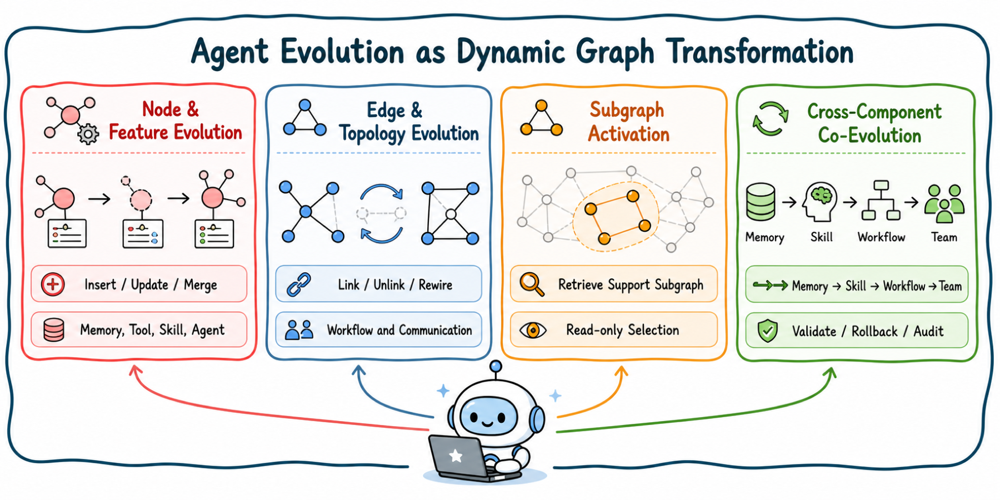

# Agent Evolution as Dynamic Graph Transformation

[Home](../README.md) · [Paper Explorer](https://luckygirl-xu.github.io/Awesome-Agent-Dynamic-Graphs/)

[Node and Feature Evolution](#node-and-feature-evolution) · [Edge and Topology Evolution](#edge-and-topology-evolution) · [Subgraph Activation](#subgraph-activation) · [Cross-Component Co-Evolution](#cross-component-co-evolution)

View the survey taxonomy

### Node and Feature Evolution

| Paper | Year |
| --- | --- |
| [Zep: A temporal knowledge graph architecture for agent memory](https://arxiv.org/abs/2501.13956) | 2025 |
| [A-MEM: Agentic Memory for LLM Agents](https://proceedings.neurips.cc/paper_files/paper/2025/hash/19909c36f51abc4856b4560aff3d36d6-Abstract-Conference.html) | 2025 |
| [MAGMA: A Multi-Graph based Agentic Memory Architecture for AI Agents](https://aclanthology.org/2026.acl-long.1709/) | 2026 |
| [APEX-MEM: Agentic Semi-Structured Memory with Temporal Reasoning for Long-Term Conversational AI](https://aclanthology.org/2026.acl-long.749/) | 2026 |
| [Structured Episodic Event Memory](https://aclanthology.org/2026.acl-long.277/) | 2026 |
| [HeLa-Mem: Hebbian Learning and Associative Memory for LLM Agents](https://aclanthology.org/2026.acl-long.625/) | 2026 |
| [ToolNet: Connecting large language models with massive tools via tool graph](https://arxiv.org/abs/2403.00839) | 2024 |
| [SkillOps: Managing LLM Agent Skill Libraries as Self-Maintaining Software Ecosystems](https://arxiv.org/abs/2605.13716) | 2026 |
| [A dynamic LLM-powered agent network for task-oriented agent collaboration](https://arxiv.org/abs/2310.02170) | 2024 |
| [TiMem: Temporal-Hierarchical Memory Consolidation for Long-Horizon Conversational Agents](https://arxiv.org/abs/2601.02845) | 2026 |
| [AriGraph: Learning Knowledge Graph World Models with Episodic Memory for LLM Agents](https://arxiv.org/abs/2407.04363) | 2025 |
| [GAAMA: Graph Augmented Associative Memory for Agents](https://arxiv.org/abs/2603.27910) | 2026 |
| [GAM: Hierarchical Graph-based Agentic Memory for LLM Agents](https://arxiv.org/abs/2604.12285) | 2026 |
| [GSEM: Graph-based Self-Evolving Memory for Experience Augmented Clinical Reasoning](https://arxiv.org/abs/2603.22096) | 2026 |
| [G-Memory: Tracing Hierarchical Memory for Multi-Agent Systems](https://arxiv.org/abs/2506.07398) | 2025 |
| [MemGPT: Towards LLMs as operating systems](https://arxiv.org/abs/2310.08560) | 2023 |
| [Memory OS of AI Agent](https://arxiv.org/abs/2506.06326) | 2025 |
| [MemMA: Coordinating the Memory Cycle through Multi-Agent Reasoning and In-Situ Self-Evolution](https://arxiv.org/abs/2603.18718) | 2026 |
| [MemRL: Self-Evolving Agents via Runtime Reinforcement Learning on Episodic Memory](https://arxiv.org/abs/2601.03192) | 2026 |
| [Evaluating very long-term conversational memory of LLM agents](https://aclanthology.org/2024.acl-long.747/) | 2024 |
| [LongMemEval: Benchmarking chat assistants on long-term interactive memory](https://arxiv.org/abs/2410.10813) | 2025 |
| [MemBench: Towards more comprehensive evaluation on the memory of LLM-based agents](https://aclanthology.org/2025.findings-acl.989/) | 2025 |
| [SkillGraph: Self-Evolving Multi-Agent Collaboration with Multimodal Graph Topology](https://arxiv.org/abs/2604.17503) | 2026 |
| [Graph of Skills: Dependency-Aware Structural Retrieval for Massive Agent Skills](https://arxiv.org/abs/2604.05333) | 2026 |
| [Voyager: An open-ended embodied agent with large language models](https://arxiv.org/abs/2305.16291) | 2024 |
| [ExpeL: LLM agents are experiential learners](https://doi.org/10.1609/aaai.v38i17.29936) | 2024 |
| [CoEvoSkills: Self-Evolving Agent Skills via Co-Evolutionary Verification](https://arxiv.org/abs/2604.01687) | 2026 |
| [EvoSkill: Automated Skill Discovery for Multi-Agent Systems](https://arxiv.org/abs/2603.02766) | 2026 |
| [SkillRL: Evolving Agents via Recursive Skill-Augmented Reinforcement Learning](https://arxiv.org/abs/2602.08234) | 2026 |
| [Agent Skill Acquisition for Large Language Models via CycleQD](https://arxiv.org/abs/2410.14735) | 2025 |
| [SEARL: Joint Optimization of Policy and Tool Graph Memory for Self-Evolving Agents](https://arxiv.org/abs/2604.07791) | 2026 |
| [NaviAgent: Bilevel Planning on Tool Navigation Graph for Large-Scale Orchestration](https://arxiv.org/abs/2506.19500) | 2025 |
| [Toolformer: Language models can teach themselves to use tools](https://arxiv.org/abs/2302.04761) | 2023 |
| [Gorilla: Large language model connected with massive APIs](https://arxiv.org/abs/2305.15334) | 2024 |
| [ToolLLM: Facilitating large language models to master 16000+ real-world APIs](https://arxiv.org/abs/2307.16789) | 2024 |
| [API-Bank: A comprehensive benchmark for tool-augmented LLMs](https://aclanthology.org/2023.emnlp-main.187/) | 2023 |
| [ToolSandbox: A stateful, conversational, interactive evaluation benchmark for LLM tool use capabilities](https://arxiv.org/abs/2408.04682) | 2025 |
| [The Berkeley Function Calling Leaderboard (BFCL): From Tool Use to Agentic Evaluation of Large Language Models](https://openreview.net/forum?id=2GmDdhBdDk) | 2025 |
| [ASTRA-bench: Evaluating Tool-Use Agent Reasoning and Action Planning with Personal User Context](https://arxiv.org/abs/2603.01357) | 2026 |
| [Cut the crap: An economical communication pipeline for LLM-based multi-agent systems](https://arxiv.org/abs/2410.02506) | 2025 |
| [AgentDropout: Dynamic Agent Elimination for Token-Efficient and High-Performance LLM-Based Multi-Agent Collaboration](https://arxiv.org/abs/2503.18891) | 2025 |
| [Learning Decentralized LLM Collaboration with Multi-Agent Actor Critic](https://arxiv.org/abs/2601.21972) | 2026 |
| [AgentScope: A flexible yet robust multi-agent platform](https://arxiv.org/abs/2402.14034) | 2024 |
| [R&D-Agent-Quant: A Multi-Agent Framework for Data-Centric Factors and Model Joint Optimization](https://proceedings.neurips.cc/paper_files/paper/2025/hash/ac5c2b6e423883cbcacbcccf88491b78-Abstract-Datasets_and_Benchmarks_Track.html) | 2025 |
| [Table-Critic: A Multi-Agent Framework for Collaborative Criticism and Refinement in Table Reasoning](https://arxiv.org/abs/2502.11799) | 2025 |
| [Verified Multi-Agent Orchestration: A Plan-Execute-Verify-Replan Framework for Complex Query Resolution](https://arxiv.org/abs/2603.11445) | 2026 |
| [Temporal graph networks for deep learning on dynamic graphs](https://arxiv.org/abs/2006.10637) | 2020 |

### Edge and Topology Evolution

| Paper | Year |
| --- | --- |
| [AFlow: Automating agentic workflow generation](https://arxiv.org/abs/2410.10762) | 2025 |
| [DynTaskMAS: A Dynamic Task Graph-driven Framework for Asynchronous and Parallel LLM-based Multi-Agent Systems](https://arxiv.org/abs/2503.07675) | 2025 |
| [Cut the crap: An economical communication pipeline for LLM-based multi-agent systems](https://arxiv.org/abs/2410.02506) | 2025 |
| [DyTopo: Dynamic Topology Routing for Multi-Agent Reasoning via Semantic Matching](https://arxiv.org/abs/2602.06039) | 2026 |
| [SkillOps: Managing LLM Agent Skill Libraries as Self-Maintaining Software Ecosystems](https://arxiv.org/abs/2605.13716) | 2026 |
| [NaviAgent: Bilevel Planning on Tool Navigation Graph for Large-Scale Orchestration](https://arxiv.org/abs/2506.19500) | 2025 |
| [Dynamic Generation of Multi-LLM Agents Communication Topologies with Graph Diffusion Models](https://arxiv.org/abs/2510.07799) | 2025 |
| [AgentConductor: Topology Evolution for Multi-Agent Competition-Level Code Generation](https://arxiv.org/abs/2602.17100) | 2026 |
| [GPTSwarm: Language agents as optimizable graphs](https://arxiv.org/abs/2402.16823) | 2024 |
| [MASS: Multi-Agent Design: Optimizing Agents with Better Prompts and Topologies](https://arxiv.org/abs/2502.02533) | 2025 |
| [ABSTRAL: Automatic Design of Multi-Agent Systems through Iterative Refinement and Topology Optimization](https://arxiv.org/abs/2603.22791) | 2026 |
| [Automated design of agentic systems](https://arxiv.org/abs/2408.08435) | 2025 |
| [A dynamic LLM-powered agent network for task-oriented agent collaboration](https://arxiv.org/abs/2310.02170) | 2024 |
| [TodyComm: Task-Oriented Dynamic Communication for Multi-Round LLM-based Multi-Agent System](https://arxiv.org/abs/2602.03688) | 2026 |
| [AgentNet: Decentralized Evolutionary Coordination for LLM-Based Multi-Agent Systems](https://proceedings.neurips.cc/paper_files/paper/2025/hash/9a379c1b05793d1c42dc832269834515-Abstract-Conference.html) | 2025 |
| [RUMAD: Reinforcement-Unifying Multi-Agent Debate](https://arxiv.org/abs/2602.23864) | 2026 |
| [ResMAS: Resilience Optimization in LLM-based Multi-agent Systems](https://arxiv.org/abs/2601.04694) | 2026 |
| [AMAS: Adaptively Determining Communication Topology for LLM-based Multi-Agent System](https://arxiv.org/abs/2510.01617) | 2025 |
| [G-Designer: Architecting Multi-Agent Communication Topologies via Graph Neural Networks](https://arxiv.org/abs/2410.11782) | 2025 |
| [Assemble Your Crew: Automatic Multi-Agent Communication Topology Design via Autoregressive Graph Generation](https://doi.org/10.1609/aaai.v40i28.39481) | 2026 |
| [Graph-of-Agents: A Graph-based Framework for Multi-Agent LLM Collaboration](https://arxiv.org/abs/2604.17148) | 2026 |
| [Adaptive Graph Pruning for Multi-Agent Communication](https://arxiv.org/abs/2506.02951) | 2025 |
| [GoAgent: Group-of-Agents Communication Topology Generation for LLM-Based Multi-Agent Systems](https://arxiv.org/abs/2603.19677) | 2026 |
| [TopoDIM: One-shot Topology Generation of Diverse Interaction Modes for Multi-Agent Systems](https://arxiv.org/abs/2601.10120) | 2026 |
| [HyperAgent: Leveraging Hypergraphs for Topology Optimization in Multi-Agent Communication](https://arxiv.org/abs/2510.10611) | 2026 |
| [AgentDropout: Dynamic Agent Elimination for Token-Efficient and High-Performance LLM-Based Multi-Agent Collaboration](https://arxiv.org/abs/2503.18891) | 2025 |
| [SafeSieve: From Heuristics to Experience in Progressive Pruning for LLM-Based Multi-Agent Communication](https://arxiv.org/abs/2508.11733) | 2026 |
| [DAGP: Difficulty-Aware Graph Pruning for LLM-Based Multi-Agent System](https://doi.org/10.1145/3746252.3760954) | 2025 |
| [Slade: Detecting dynamic anomalies in edge streams without labels via self-supervised learning](https://arxiv.org/abs/2402.11933) | 2024 |

### Subgraph Activation

| Paper | Year |
| --- | --- |
| [Think-on-Graph 3.0: Efficient and Adaptive LLM Reasoning on Heterogeneous Graphs via Multi-Agent Dual-Evolving Context Retrieval](https://arxiv.org/abs/2509.21710) | 2025 |
| [Zep: A temporal knowledge graph architecture for agent memory](https://arxiv.org/abs/2501.13956) | 2025 |
| [A dynamic LLM-powered agent network for task-oriented agent collaboration](https://arxiv.org/abs/2310.02170) | 2024 |
| [DyTopo: Dynamic Topology Routing for Multi-Agent Reasoning via Semantic Matching](https://arxiv.org/abs/2602.06039) | 2026 |
| [TopoDIM: One-shot Topology Generation of Diverse Interaction Modes for Multi-Agent Systems](https://arxiv.org/abs/2601.10120) | 2026 |
| [MemGPT: Towards LLMs as operating systems](https://arxiv.org/abs/2310.08560) | 2023 |
| [MemoryBank: Enhancing large language models with long-term memory](https://arxiv.org/abs/2305.10250) | 2024 |
| [Memory OS of AI Agent](https://arxiv.org/abs/2506.06326) | 2025 |
| [Assemble Your Crew: Automatic Multi-Agent Communication Topology Design via Autoregressive Graph Generation](https://doi.org/10.1609/aaai.v40i28.39481) | 2026 |
| [Voyager: An open-ended embodied agent with large language models](https://arxiv.org/abs/2305.16291) | 2024 |
| [AgentSquare: Automatic LLM agent search in modular design space](https://arxiv.org/abs/2410.06153) | 2025 |
| [DyFlow: Dynamic Workflow Framework for Agentic Reasoning](https://papers.nips.cc/paper_files/paper/2025/hash/fe9910d2b03324faeb5371a9658277bb-Abstract-Conference.html) | 2025 |
| [VIPAct: Visual-Perception Enhancement via Specialized VLM Agent Collaboration and Tool-Use](https://doi.org/10.1609/aaai.v40i43.40976) | 2026 |
| [AgentBench: Evaluating LLMs as agents](https://arxiv.org/abs/2308.03688) | 2024 |
| [GAIA: A benchmark for general AI assistants](https://arxiv.org/abs/2311.12983) | 2024 |
| [SWE-bench: Can language models resolve real-world GitHub issues?](https://arxiv.org/abs/2310.06770) | 2024 |
| [tau-bench: A benchmark for tool-agent-user interaction in real-world domains](https://arxiv.org/abs/2406.12045) | 2024 |
| [OSWorld: Benchmarking multimodal agents for open-ended tasks in real computer environments](https://doi.org/10.52202/079017-1650) | 2024 |
| [Mind2Web: Towards a generalist agent for the web](https://doi.org/10.52202/075280-1220) | 2023 |
| [Benchmarking Agentic Workflow Generation](https://arxiv.org/abs/2410.07869) | 2025 |
| [Ranking on dynamic graphs: An effective and robust band-pass disentangled approach](https://openreview.net/forum?id=cah0ZYeMz0) | 2025 |
| [Rush: Real-time burst subgraph detection in dynamic graphs](https://doi.org/10.14778/3681954.3682028) | 2024 |

### Cross-Component Co-Evolution

| Paper | Year |
| --- | --- |
| [MetaGen: Self-Evolving Roles and Topologies for Multi-Agent LLM Reasoning](https://arxiv.org/abs/2601.19290) | 2026 |
| [TacoMAS: Test-Time Co-Evolution of Topology and Capability in LLM-based Multi-Agent Systems](https://arxiv.org/abs/2605.09539) | 2026 |
| [SkillGraph: Self-Evolving Multi-Agent Collaboration with Multimodal Graph Topology](https://arxiv.org/abs/2604.17503) | 2026 |
| [Self-Evolving Multi-Agent Collaboration Networks for Software Development](https://openreview.net/forum?id=4R71pdPBZp) | 2025 |
| [TopoEvo: A Topology-Aware Self-Evolving Multi-Agent Framework for Root Cause Analysis in Microservices](https://arxiv.org/abs/2605.15611) | 2026 |
| [GUARDIAN: Safeguarding LLM Multi-Agent Collaborations with Temporal Graph Modeling](https://arxiv.org/abs/2505.19234) | 2025 |
| [SentinelAgent: Graph-based Anomaly Detection in Multi-Agent Systems](https://arxiv.org/abs/2505.24201) | 2025 |
| [G-Safeguard: A Topology-Guided Security Lens and Treatment on LLM-Based Multi-Agent Systems](https://aclanthology.org/2025.acl-long.359/) | 2025 |
| [Self-Refine: Iterative refinement with self-feedback](https://doi.org/10.52202/075280-2019) | 2023 |
| [ExpeL: LLM agents are experiential learners](https://doi.org/10.1609/aaai.v38i17.29936) | 2024 |
| [Agent hospital: A simulacrum of hospital with evolvable medical agents](https://arxiv.org/abs/2405.02957) | 2024 |
| [AutoAct: Automatic agent learning from scratch for QA via self-planning](https://arxiv.org/abs/2401.05268) | 2024 |
| [Synthesizing Multi-Agent Harnesses for Vulnerability Discovery](https://arxiv.org/abs/2604.20801) | 2026 |
| [A Safety and Security Framework for Real-World Agentic Systems](https://arxiv.org/abs/2511.21990) | 2025 |
| [On-Policy Self-Evolution via Failure Trajectories for Agentic Safety Alignment](https://arxiv.org/abs/2605.11882) | 2026 |
| [DyTopo: Dynamic Topology Routing for Multi-Agent Reasoning via Semantic Matching](https://arxiv.org/abs/2602.06039) | 2026 |

[Back to the full paper lists](../README.md#full-paper-lists)
