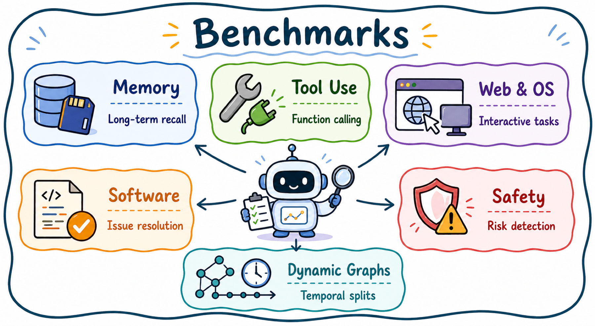

# Benchmarks

[Home](../README.md) · [Paper Explorer](https://luckygirl-xu.github.io/Awesome-Agent-Dynamic-Graphs/)

[Memory](#memory) · [Tool Use](#tool-use) · [Web & OS](#web--os) · [Software](#software) · [Safety](#safety) · [Dynamic Graphs](#dynamic-graphs)

View the survey taxonomy

### Memory

| Paper | Year |
| --- | --- |
| [Evaluating very long-term conversational memory of LLM agents](https://aclanthology.org/2024.acl-long.747/) | 2024 |
| [LongMemEval: Benchmarking chat assistants on long-term interactive memory](https://arxiv.org/abs/2410.10813) | 2025 |
| [MemBench: Towards more comprehensive evaluation on the memory of LLM-based agents](https://aclanthology.org/2025.findings-acl.989/) | 2025 |

### Tool Use

| Paper | Year |
| --- | --- |
| [API-Bank: A comprehensive benchmark for tool-augmented LLMs](https://aclanthology.org/2023.emnlp-main.187/) | 2023 |
| [ToolSandbox: A stateful, conversational, interactive evaluation benchmark for LLM tool use capabilities](https://arxiv.org/abs/2408.04682) | 2025 |
| [The Berkeley Function Calling Leaderboard (BFCL): From Tool Use to Agentic Evaluation of Large Language Models](https://openreview.net/forum?id=2GmDdhBdDk) | 2025 |
| [ASTRA-bench: Evaluating Tool-Use Agent Reasoning and Action Planning with Personal User Context](https://arxiv.org/abs/2603.01357) | 2026 |
| [AgentBench: Evaluating LLMs as agents](https://arxiv.org/abs/2308.03688) | 2024 |
| [GAIA: A benchmark for general AI assistants](https://arxiv.org/abs/2311.12983) | 2024 |
| [TravelPlanner: A benchmark for real-world planning with language agents](https://arxiv.org/abs/2402.01622) | 2024 |
| [tau-bench: A benchmark for tool-agent-user interaction in real-world domains](https://arxiv.org/abs/2406.12045) | 2024 |
| [Benchmarking Agentic Workflow Generation](https://arxiv.org/abs/2410.07869) | 2025 |

### Web & OS

| Paper | Year |
| --- | --- |
| [WebArena: A realistic web environment for building autonomous agents](https://arxiv.org/abs/2307.13854) | 2024 |
| [VisualWebArena: Evaluating multimodal agents on realistic visual web tasks](https://aclanthology.org/2024.acl-long.50/) | 2024 |
| [Mind2Web: Towards a generalist agent for the web](https://doi.org/10.52202/075280-1220) | 2023 |
| [WebVoyager: Building an end-to-end web agent with large multimodal models](https://aclanthology.org/2024.acl-long.371/) | 2024 |
| [OSWorld: Benchmarking multimodal agents for open-ended tasks in real computer environments](https://doi.org/10.52202/079017-1650) | 2024 |

### Software

| Paper | Year |
| --- | --- |
| [AppWorld: A controllable world of apps and people for benchmarking interactive coding agents](https://aclanthology.org/2024.acl-long.850/) | 2024 |
| [SWE-bench: Can language models resolve real-world GitHub issues?](https://arxiv.org/abs/2310.06770) | 2024 |
| [Introducing SWE-bench Verified](https://openai.com/index/introducing-swe-bench-verified/) | 2024 |
| [SaaSBench: Exploring the Boundaries of Coding Agents in Long-Horizon Enterprise SaaS Engineering](https://arxiv.org/abs/2605.17526) | 2026 |

### Safety

| Paper | Year |
| --- | --- |
| [Identifying the risks of LM agents with an LM-emulated sandbox](https://arxiv.org/abs/2309.15817) | 2024 |
| [AgentDojo: A dynamic environment to evaluate prompt injection attacks and defenses for LLM agents](https://doi.org/10.52202/079017-2636) | 2024 |
| [AgentHarm: A benchmark for measuring harmfulness of LLM agents](https://arxiv.org/abs/2410.09024) | 2025 |
| [Agent security bench (ASB): Formalizing and benchmarking attacks and defenses in LLM-based agents](https://arxiv.org/abs/2410.02644) | 2025 |

### Dynamic Graphs

| Paper | Year |
| --- | --- |
| [Temporal graph benchmark for machine learning on temporal graphs](https://doi.org/10.52202/075280-0099) | 2023 |
| [Towards better evaluation for dynamic link prediction](https://arxiv.org/abs/2207.10128) | 2022 |
| [DTGB: A comprehensive benchmark for dynamic text-attributed graphs](https://doi.org/10.52202/079017-2901) | 2024 |
| [GDGB: A Benchmark for Generative Dynamic Text-Attributed Graph Learning](https://arxiv.org/abs/2507.03267) | 2026 |

[Back to the full paper lists](../README.md#full-paper-lists)
