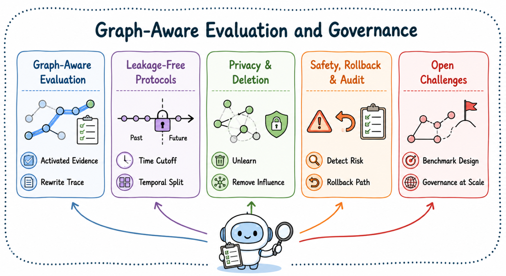

# Graph-Aware Evaluation and Governance

[Home](../README.md) · [Paper Explorer](https://luckygirl-xu.github.io/Awesome-Agent-Dynamic-Graphs/)

[Graph-Aware Evaluation](#graph-aware-evaluation) · [Leakage-Free Temporal Protocols](#leakage-free-temporal-protocols) · [Privacy and Deletion in Evolving Agent Graphs](#privacy-and-deletion-in-evolving-agent-graphs) · [Safety, Rollback, and Audit](#safety-rollback-and-audit) · [Open Challenges](#open-challenges)

View the survey taxonomy

### Graph-Aware Evaluation

| Paper | Year |
| --- | --- |
| [Evaluating White Matter Lesion Segmentations with Refined Sørensen-Dice Analysis](https://doi.org/10.1038/s41598-020-64803-w) | 2020 |
| [Evaluating very long-term conversational memory of LLM agents](https://aclanthology.org/2024.acl-long.747/) | 2024 |
| [LongMemEval: Benchmarking chat assistants on long-term interactive memory](https://arxiv.org/abs/2410.10813) | 2025 |
| [MemBench: Towards more comprehensive evaluation on the memory of LLM-based agents](https://aclanthology.org/2025.findings-acl.989/) | 2025 |
| [From local to global: A graph RAG approach to query-focused summarization](https://arxiv.org/abs/2404.16130) | 2024 |
| [Graph retrieval-augmented generation: A survey](https://arxiv.org/abs/2408.08921) | 2025 |
| [Locating and editing factual associations in GPT](https://arxiv.org/abs/2202.05262) | 2022 |
| [Mass-editing memory in a transformer](https://arxiv.org/abs/2210.07229) | 2023 |
| [Fast model editing at scale](https://arxiv.org/abs/2110.11309) | 2022 |
| [Editing large language models: Problems, methods, and opportunities](https://aclanthology.org/2023.emnlp-main.632/) | 2023 |
| [ToolSandbox: A stateful, conversational, interactive evaluation benchmark for LLM tool use capabilities](https://arxiv.org/abs/2408.04682) | 2025 |
| [The Berkeley Function Calling Leaderboard (BFCL): From Tool Use to Agentic Evaluation of Large Language Models](https://openreview.net/forum?id=2GmDdhBdDk) | 2025 |
| [AgentBench: Evaluating LLMs as agents](https://arxiv.org/abs/2308.03688) | 2024 |
| [WebArena: A realistic web environment for building autonomous agents](https://arxiv.org/abs/2307.13854) | 2024 |
| [VisualWebArena: Evaluating multimodal agents on realistic visual web tasks](https://aclanthology.org/2024.acl-long.50/) | 2024 |
| [Mind2Web: Towards a generalist agent for the web](https://doi.org/10.52202/075280-1220) | 2023 |
| [WebVoyager: Building an end-to-end web agent with large multimodal models](https://aclanthology.org/2024.acl-long.371/) | 2024 |
| [TravelPlanner: A benchmark for real-world planning with language agents](https://arxiv.org/abs/2402.01622) | 2024 |
| [OSWorld: Benchmarking multimodal agents for open-ended tasks in real computer environments](https://doi.org/10.52202/079017-1650) | 2024 |
| [AppWorld: A controllable world of apps and people for benchmarking interactive coding agents](https://aclanthology.org/2024.acl-long.850/) | 2024 |
| [SWE-bench: Can language models resolve real-world GitHub issues?](https://arxiv.org/abs/2310.06770) | 2024 |
| [Introducing SWE-bench Verified](https://openai.com/index/introducing-swe-bench-verified/) | 2024 |
| [SaaSBench: Exploring the Boundaries of Coding Agents in Long-Horizon Enterprise SaaS Engineering](https://arxiv.org/abs/2605.17526) | 2026 |

<em>These related works highlight the necessity of Graph-Aware Evaluation.</em>

### Leakage-Free Temporal Protocols

| Paper | Year |
| --- | --- |
| [Temporal graph benchmark for machine learning on temporal graphs](https://doi.org/10.52202/075280-0099) | 2023 |
| [Towards better evaluation for dynamic link prediction](https://doi.org/10.52202/068431-2386) | 2022 |

### Privacy and Deletion in Evolving Agent Graphs

| Paper | Year |
| --- | --- |
| [Graph unlearning](https://doi.org/10.1145/3548606.3559352) | 2022 |
| [Efficient model updates for approximate unlearning of graph-structured data](https://openreview.net/forum?id=fhcu4FBLciL) | 2023 |
| [GIF: A general graph unlearning strategy via influence function](https://doi.org/10.1145/3543507.3583521) | 2023 |
| [GNNDelete: A general strategy for unlearning in graph neural networks](https://arxiv.org/abs/2302.13406) | 2023 |

### Safety, Rollback, and Audit

| Paper | Year |
| --- | --- |
| [Identifying the risks of LM agents with an LM-emulated sandbox](https://arxiv.org/abs/2309.15817) | 2024 |
| [AgentDojo: A dynamic environment to evaluate prompt injection attacks and defenses for LLM agents](https://doi.org/10.52202/079017-2636) | 2024 |
| [AgentHarm: A benchmark for measuring harmfulness of LLM agents](https://arxiv.org/abs/2410.09024) | 2025 |
| [Agent security bench (ASB): Formalizing and benchmarking attacks and defenses in LLM-based agents](https://arxiv.org/abs/2410.02644) | 2025 |
| [Explainability in graph neural networks: A taxonomic survey](https://doi.org/10.1109/TPAMI.2022.3204236) | 2023 |
| [Explaining temporal graph models through an explorer-navigator framework](https://openreview.net/forum?id=BR_ZhvcYbGJ) | 2023 |
| [Causality-inspired spatial-temporal explanations for dynamic graph neural networks](https://openreview.net/forum?id=AJBkfwXh3u) | 2024 |

### Open Challenges

| Paper | Year |
| --- | --- |
| [Learning Query-Aware Budget-Tier Routing for Runtime Agent Memory](https://arxiv.org/abs/2602.06025) | 2026 |
| [ToolNet: Connecting large language models with massive tools via tool graph](https://arxiv.org/abs/2403.00839) | 2024 |
| [NaviAgent: Bilevel Planning on Tool Navigation Graph for Large-Scale Orchestration](https://arxiv.org/abs/2506.19500) | 2025 |
| [SkillOps: Managing LLM Agent Skill Libraries as Self-Maintaining Software Ecosystems](https://arxiv.org/abs/2605.13716) | 2026 |
| [TacoMAS: Test-Time Co-Evolution of Topology and Capability in LLM-based Multi-Agent Systems](https://arxiv.org/abs/2605.09539) | 2026 |

<em>These related works motivate our Open Challenges.</em>

[Back to the full paper lists](../README.md#full-paper-lists)
