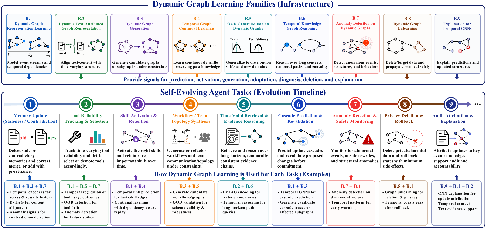

# Dynamic Graph Learning as Agent-Evolution Infrastructure

[Home](../README.md) · [Paper Explorer](https://luckygirl-xu.github.io/Awesome-Agent-Dynamic-Graphs/)

[Dynamic Graph Representation Learning](#dynamic-graph-representation-learning) · [Dynamic Text-Attributed Graphs](#dynamic-text-attributed-graphs) · [Dynamic Graph Generation](#dynamic-graph-generation) · [Continual Learning on Dynamic Graphs](#continual-learning-on-dynamic-graphs) · [Out-of-Distribution Generalization on Dynamic Graphs](#out-of-distribution-generalization-on-dynamic-graphs) · [Temporal Knowledge Graph Reasoning](#temporal-knowledge-graph-reasoning) · [Anomaly Detection on Dynamic Graphs](#anomaly-detection-on-dynamic-graphs) · [Dynamic Graph Unlearning](#dynamic-graph-unlearning) · [Explanation for Temporal GNNs](#explanation-for-temporal-gnns)

View the survey taxonomy

### Dynamic Graph Representation Learning

| Paper | Year |
| --- | --- |
| [UniDyG: A Unified and Effective Representation Learning Approach for Large Dynamic Graphs](https://doi.org/10.1109/TKDE.2025.3566064) | 2025 |
| [Temporal graph networks for deep learning on dynamic graphs](https://arxiv.org/abs/2006.10637) | 2020 |
| [Towards better dynamic graph learning: New architecture and unified library](https://doi.org/10.52202/075280-2960) | 2023 |
| [Do we really need complicated model architectures for temporal networks?](https://arxiv.org/abs/2302.11636) | 2023 |
| [FreeDyG: Frequency Enhanced Continuous-Time Dynamic Graph Model for Link Prediction](https://openreview.net/forum?id=82Mc5ilInM) | 2024 |
| [SALoM: Structure Aware Temporal Graph Networks with Long-Short Memory Updater](https://papers.neurips.cc/paper_files/paper/2025/hash/20f94998511f25bb6378cae0e098bc46-Abstract-Conference.html) | 2025 |
| [Simple: Efficient temporal graph neural network training at scale with dynamic data placement](https://doi.org/10.1145/3654977) | 2024 |
| [ETC: Efficient Training of Temporal Graph Neural Networks over Large-Scale Dynamic Graphs](https://doi.org/10.14778/3641204.3641215) | 2024 |
| [On the scalability of temporal relative positional encoding for dynamic link prediction](https://doi.org/10.1145/3711896.3737069) | 2025 |
| [Repeat-Aware Neighbor Sampling for Dynamic Graph Learning](https://doi.org/10.1145/3637528.3672001) | 2024 |
| [Neighborhood-aware scalable temporal network representation learning](https://arxiv.org/abs/2209.01084) | 2022 |
| [Long Range Propagation on Continuous-Time Dynamic Graphs](https://arxiv.org/abs/2406.02740) | 2024 |
| [Robust knowledge adaptation for dynamic graph neural networks](https://doi.org/10.1109/TKDE.2024.3388453) | 2024 |
| [Co-Neighbor Encoding Schema: A Light-cost Structure Encoding Method for Dynamic Link Prediction](https://arxiv.org/abs/2407.20871) | 2024 |
| [Retrieval augmented generation for dynamic graph modeling](https://arxiv.org/abs/2408.14523) | 2025 |
| [Towards better evaluation for dynamic link prediction](https://arxiv.org/abs/2207.10128) | 2022 |
| [Event-based dynamic graph representation learning for patent application trend prediction](https://doi.org/10.1109/TKDE.2023.3312333) | 2024 |
| [Representation learning for dynamic graphs: A survey](https://jmlr.org/papers/v21/19-447.html) | 2020 |
| [State space models on temporal graphs: A first-principles study](https://arxiv.org/abs/2406.00943) | 2024 |
| [Supra-laplacian encoding for transformer on dynamic graphs](https://arxiv.org/abs/2409.17986) | 2024 |
| [Foundations and modeling of dynamic networks using dynamic graph neural networks: A survey](https://doi.org/10.1109/ACCESS.2021.3082932) | 2021 |
| [Graph neural networks for temporal graphs: State of the art, open challenges, and opportunities](https://arxiv.org/abs/2302.01018) | 2023 |
| [dyngraph2vec: Capturing network dynamics using dynamic graph representation learning](https://doi.org/10.1016/j.knosys.2019.06.024) | 2020 |
| [DySAT: Deep neural representation learning on dynamic graphs via self-attention networks](https://arxiv.org/abs/1812.09430) | 2020 |
| [EvolveGCN: Evolving graph convolutional networks for dynamic graphs](https://doi.org/10.1609/aaai.v34i04.5984) | 2020 |
| [ROLAND: Graph learning framework for dynamic graphs](https://doi.org/10.1145/3534678.3539300) | 2022 |
| [A novel representation learning for dynamic graphs based on graph convolutional networks](https://doi.org/10.1109/TCYB.2022.3159661) | 2022 |
| [HGWaveNet: A Hyperbolic Graph Neural Network for Temporal Link Prediction](https://arxiv.org/abs/2304.07302) | 2023 |
| [SEIGN: A Simple and Efficient Graph Neural Network for Large Dynamic Graphs](https://doi.org/10.1109/ICDE55515.2023.00218) | 2023 |
| [An Attentional Multi-scale Co-evolving Model for Dynamic Link Prediction](https://dl.acm.org/doi/10.1145/3543507.3583396) | 2023 |
| [Scaling Up Dynamic Graph Representation Learning via Spiking Neural Networks](https://arxiv.org/abs/2208.10364) | 2023 |
| [High-quality temporal link prediction for weighted dynamic graphs via inductive embedding aggregation](https://doi.org/10.1109/TKDE.2023.3238360) | 2023 |

### Dynamic Text-Attributed Graphs

| Paper | Year |
| --- | --- |
| [DTGB: A comprehensive benchmark for dynamic text-attributed graphs](https://doi.org/10.52202/079017-2901) | 2024 |
| [Unlocking multi-modal potentials for link prediction on dynamic text-attributed graphs](https://arxiv.org/abs/2502.19651) | 2026 |
| [Unifying Text Semantics and Graph Structures for Temporal Text-attributed Graphs with Large Language Models](https://arxiv.org/abs/2503.14411) | 2025 |
| [LLM-driven Knowledge Distillation for Dynamic Text-Attributed Graphs](https://arxiv.org/abs/2502.10914) | 2025 |
| [Global-Recent Semantic Reasoning on Dynamic Text-Attributed Graphs with Large Language Models](https://arxiv.org/abs/2509.18742) | 2025 |
| [Exploring the potential of large language models as predictors in dynamic text-attributed graphs](https://arxiv.org/abs/2503.03258) | 2025 |

### Dynamic Graph Generation

| Paper | Year |
| --- | --- |
| [TG-GAN: Continuous-time temporal graph deep generative models with time-validity constraints](https://doi.org/10.1145/3442381.3449818) | 2021 |
| [A data-driven graph generative model for temporal interaction networks](https://doi.org/10.1145/3394486.3403082) | 2020 |
| [TIGGER: Scalable generative modelling for temporal interaction graphs](https://doi.org/10.1609/aaai.v36i6.20638) | 2022 |
| [A deep probabilistic framework for continuous time dynamic graph generation](https://arxiv.org/abs/2412.15582) | 2025 |
| [Efficient dynamic attributed graph generation](https://arxiv.org/abs/2412.08810) | 2025 |
| [GDGB: A Benchmark for Generative Dynamic Text-Attributed Graph Learning](https://arxiv.org/abs/2507.03267) | 2026 |

### Continual Learning on Dynamic Graphs

| Paper | Year |
| --- | --- |
| [A Selective Learning Method for Temporal Graph Continual Learning](https://arxiv.org/abs/2503.01580) | 2025 |
| [TOWARDS OPEN TEMPORAL GRAPH NEURAL NETWORKS](https://arxiv.org/abs/2303.15015) | 2023 |
| [Continual learning on dynamic graphs via parameter isolation](https://doi.org/10.1145/3539618.3591652) | 2023 |

### Out-of-Distribution Generalization on Dynamic Graphs

| Paper | Year |
| --- | --- |
| [Dynamic graph neural networks under spatio-temporal distribution shift](https://doi.org/10.52202/068431-0440) | 2022 |
| [Spectral invariant learning for dynamic graphs under distribution shifts](https://doi.org/10.52202/075280-0290) | 2023 |
| [Environment-Aware Dynamic Graph Learning for Out-of-Distribution Generalization](https://doi.org/10.52202/075280-2164) | 2023 |
| [Evolving Graph Learning for Out-of-Distribution Generalization in Non-stationary Environments](https://arxiv.org/abs/2511.02354) | 2026 |

### Temporal Knowledge Graph Reasoning

| Paper | Year |
| --- | --- |
| [Explainable subgraph reasoning for forecasting on temporal knowledge graphs](https://openreview.net/forum?id=pGIHq1m7PU) | 2021 |
| [HyTE: Hyperplane-based temporally aware knowledge graph embedding](https://aclanthology.org/D18-1225/) | 2018 |
| [TeMP: Temporal message passing for temporal knowledge graph completion](https://aclanthology.org/2020.emnlp-main.462/) | 2020 |
| [Tensor decompositions for temporal knowledge base completion](https://arxiv.org/abs/2004.04926) | 2020 |
| [Know-Evolve: Deep temporal reasoning for dynamic knowledge graphs](https://arxiv.org/abs/1705.05742) | 2017 |
| [Recurrent Event Network: Autoregressive Structure Inference over Temporal Knowledge Graphs](https://aclanthology.org/2020.emnlp-main.541/) | 2020 |
| [Learning from history: Modeling temporal knowledge graphs with sequential copy-generation networks](https://doi.org/10.1609/aaai.v35i5.16604) | 2021 |
| [Temporal knowledge graph reasoning based on evolutional representation learning](https://doi.org/10.1145/3404835.3462963) | 2021 |
| [Integrate Temporal Graph Learning into LLM-based Temporal Knowledge Graph Model](https://arxiv.org/abs/2501.11911) | 2025 |
| [Enhancing Temporal Knowledge Graph Forecasting with Large Language Models via Chain-of-History Reasoning](https://arxiv.org/abs/2402.14382) | 2024 |
| [GenTKG: Generative forecasting on temporal knowledge graph with large language models](https://aclanthology.org/2024.findings-naacl.268/) | 2024 |

### Anomaly Detection on Dynamic Graphs

| Paper | Year |
| --- | --- |
| [AgentDojo: A dynamic environment to evaluate prompt injection attacks and defenses for LLM agents](https://doi.org/10.52202/079017-2636) | 2024 |
| [Agent security bench (ASB): Formalizing and benchmarking attacks and defenses in LLM-based agents](https://arxiv.org/abs/2410.02644) | 2025 |
| [Not what you've signed up for: Compromising real-world LLM-integrated applications with indirect prompt injection](https://doi.org/10.1145/3605764.3623985) | 2023 |
| [SentinelAgent: Graph-based Anomaly Detection in Multi-Agent Systems](https://arxiv.org/abs/2505.24201) | 2025 |
| [Anomaly Detection in Dynamic Graphs: A Comprehensive Survey](https://doi.org/10.1145/3669906) | 2024 |
| [Structural temporal graph neural networks for anomaly detection in dynamic graphs](https://doi.org/10.1145/3459637.3481955) | 2021 |
| [Anonymous Edge Representation for Inductive Anomaly Detection in Dynamic Bipartite Graph](https://doi.org/10.14778/3579075.3579088) | 2023 |
| [AddGraph: Anomaly detection in dynamic graph using attention-based temporal GCN](https://www.ijcai.org/proceedings/2019/614) | 2019 |
| [Anomaly detection in dynamic graphs via transformer](https://doi.org/10.1109/TKDE.2021.3124061) | 2023 |
| [Slade: Detecting dynamic anomalies in edge streams without labels via self-supervised learning](https://arxiv.org/abs/2402.11933) | 2024 |

### Dynamic Graph Unlearning

| Paper | Year |
| --- | --- |
| [Dynamic graph unlearning: a general and efficient post-processing method via gradient transformation](https://arxiv.org/abs/2405.14407) | 2025 |
| [Spatio-Temporal Graph Unlearning](https://arxiv.org/abs/2511.09404) | 2025 |

### Explanation for Temporal GNNs

| Paper | Year |
| --- | --- |
| [Explaining temporal graph models through an explorer-navigator framework](https://openreview.net/forum?id=BR_ZhvcYbGJ) | 2023 |
| [DyExplainer: Self-explainable dynamic graph neural network with sparse attentions](https://doi.org/10.1145/3729173) | 2025 |
| [Causality-inspired spatial-temporal explanations for dynamic graph neural networks](https://openreview.net/forum?id=AJBkfwXh3u) | 2024 |

[Back to the full paper lists](../README.md#full-paper-lists)
